# Funktionen

BlechWiki beantwortet eine Frage: In welchem Bläserheft steht dieses Stück, und haben wir das Heft im Notenschrank? Die Daten kommen von [blechwiki.de](https://www.blechwiki.de/), gesucht wird lokal auf dem Gerät.

Screenshots: links Android (Galaxy S8, Android 9), rechts iOS (Simulator iPhone 18 Pro). Beide mit Landeskirche Nordelbien und demselben Inventar aus 6 Büchern.

[← Zurück zur README](../README.md)

## Startseite

| Android | iOS |
|:---:|:---:|
| 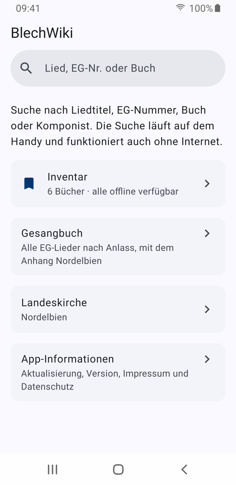 | 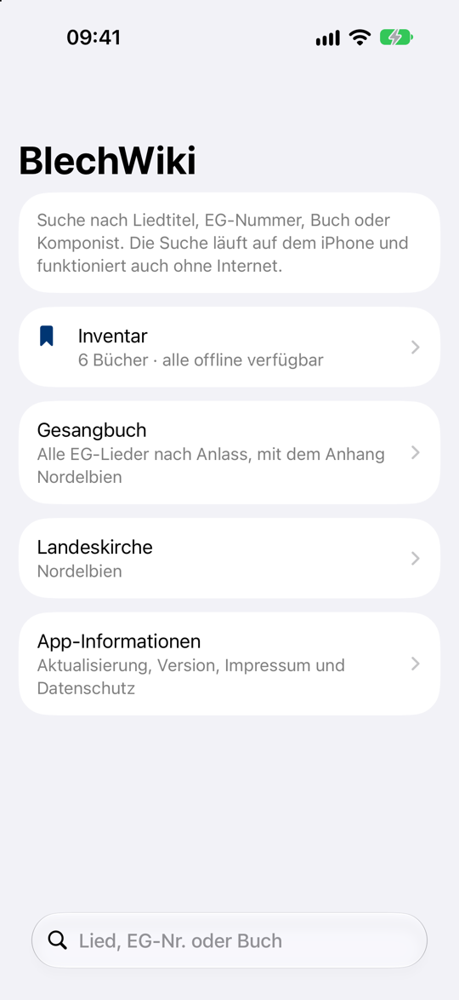 |

- Beim ersten Start erklärt eine Tour auf vier Seiten Suche, Suchergebnisse, Inventar und Gesangbuch, jeweils mit Screenshot. Wischen oder „Weiter“ blättert, „Überspringen“ oder „Einrichten“ öffnet die Einrichtung. Die sieht aus wie eine normale Seite der App, damit klar ist, dass hier etwas einzustellen ist: In Schritt 1 wählt man die Landeskirche, in Schritt 2 hakt man die ersten Hefte fürs Inventar an, aus den Vorschlägen für die Landeskirche und den Choralbüchern. Wer schon eine Landeskirche oder Bücher eingetragen hat, sieht die Einführung nicht. Über „Hilfe“ auf der Startseite lässt sie sich jederzeit wieder öffnen, mit „Schließen“ oben links. Auf dem Mac steht sie auch im Menü „Hilfe“ unter „Einführung ansehen“.
- Alle Bücher und ihr Inhalt sind in der App enthalten. Währenddessen lädt die App im Hintergrund Bücher, Komponisten und Lieder (einmalig etwa 1 MB) und neue Einträge seit dem Stand der App. Danach läuft die Suche ohne Internet. Ist das Verzeichnis bei der Bücherauswahl noch nicht da, zeigt die Seite den Ladestand. Die Landeskirche lässt sich auch ohne Netz wählen, dafür hat die App eine eingebaute Liste.
- **Inventar** zeigt, wie viele Bücher eingetragen sind.
- **Listen** zeigt, wie viele Favoriten und weitere Listen es gibt, siehe unten.
- **Gesangbuch** öffnet alle EG-Lieder nach Anlass, siehe unten.
- **Einstellungen** enthält oben die **Landeskirche**. Sie legt fest, welche Nummern aus den EG-Anhängen erscheinen und welche Hefte im Inventar vorgeschlagen werden. Darunter erklärt die Seite, wie die App ihre Daten aktualisiert, und zeigt das Datum der letzten Prüfung, die Versionsnummer sowie Links zu Impressum und Datenschutzerklärung. Die App fragt höchstens einmal am Tag nach neuen und korrigierten Büchern, Liedern und Komponisten und lädt nur, was sich geändert hat. „Alle Daten neu laden“ holt nach einer Rückfrage alles neu von blechwiki.de (etwa 9 MB), falls Einträge fehlen oder falsch sind. Auf dem Mac steht der Befehl auch im Menü „Darstellung“.
- **Hilfe** öffnet die Einführung erneut.

## Suche

| Android | iOS |
|:---:|:---:|
| 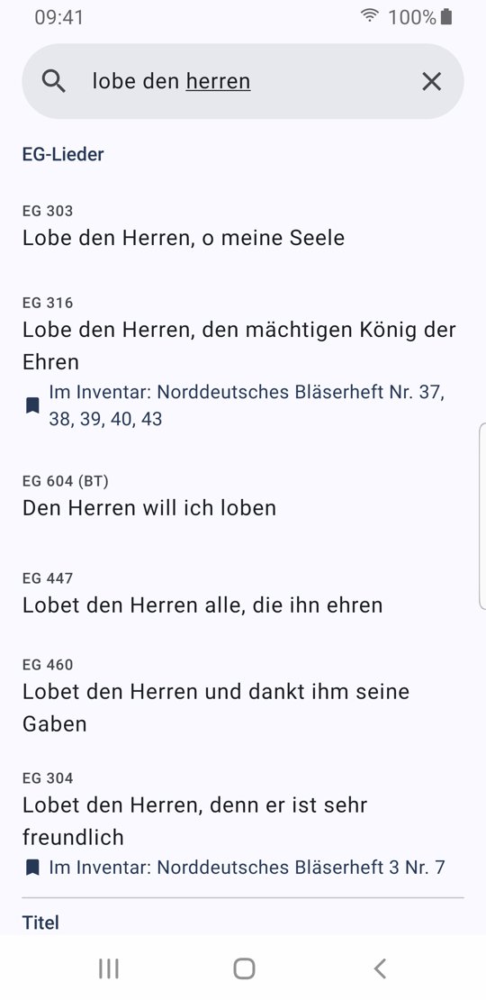 | 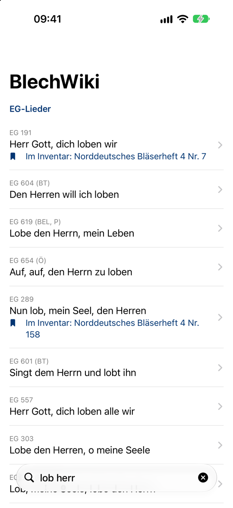 |

- Ein Suchfeld für Liedtitel, EG-Nummer, Buch und Komponist. Wortanfänge reichen, „lob herr“ findet „Lobe den Herren“.
- Treffer sind gruppiert: EG-Lieder, Titel, Bücher, Komponisten. EG-Lieder stehen oben.
- Steht ein Stück in einem Buch aus dem Inventar, zeigt die Trefferliste das direkt mit Buch und Nummer an, hier „Norddeutsches Bläserheft 4 Nr. 7“.
- Auf iOS 26 und neuer sitzt das Suchfeld unten, in Reichweite des Daumens. Auf älteren Versionen steht es oben unter dem Titel.

## Suchergebnisse

| Android | iOS |
|:---:|:---:|
| 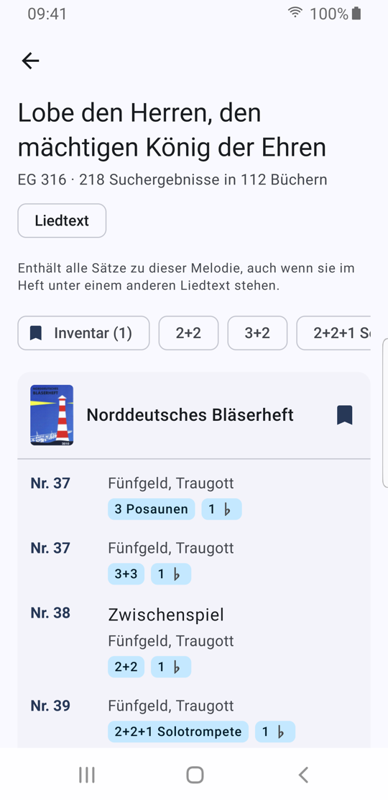 | 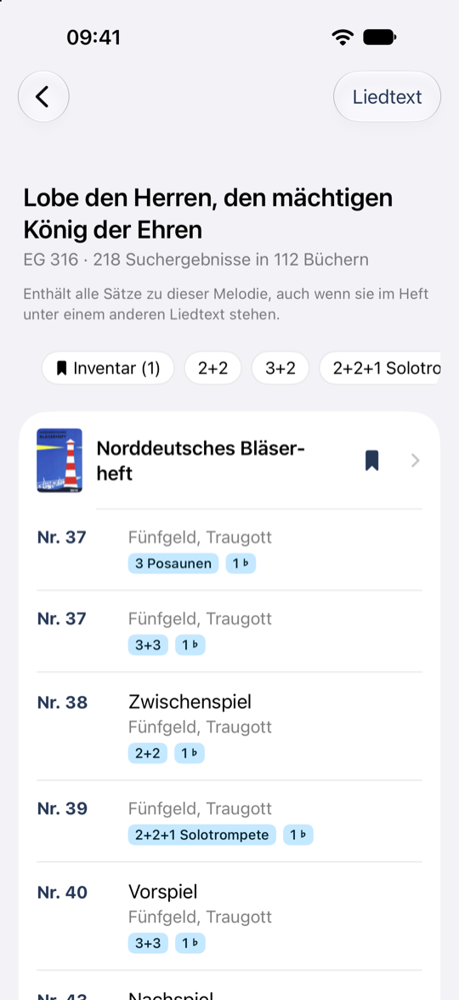 |

- Alle Bücher, in denen ein Lied steht, mit Nummer, Bearbeiter, Besetzung und Vorzeichen. Im Bild „This little Light of mine“: 5 Bücher, 2 davon im Inventar.
- Ein Tipp auf einen Bearbeiter oder Komponisten zeigt alle seine Stücke, wie die Suche nach ihm. Namen ohne Eintrag bei BlechWiki, etwa „NN“, sind nicht verlinkt.
- Bei EG-Liedern zählt die Melodie. Die Liste enthält auch Sätze, die im Heft unter einem anderen Liedtext stehen.
- Filter oben: nur Bücher aus dem Inventar oder eine bestimmte Besetzung (2+2, 3+2, 2+2+1 Solotrompete …).
- Bücher aus dem Inventar stehen zuerst. Das Lesezeichen am Buch nimmt es ins Inventar auf oder entfernt es.
- Suchergebnisse kommen ohne Internet aus. Unten steht, wann die Daten zuletzt mit blechwiki.de abgeglichen wurden. Öffnet man ein Buch, prüft die App höchstens alle 30 Tage, ob Stücke daraus bei blechwiki.de gelöscht wurden.

## Buchansicht

| Android | iOS |
|:---:|:---:|
| 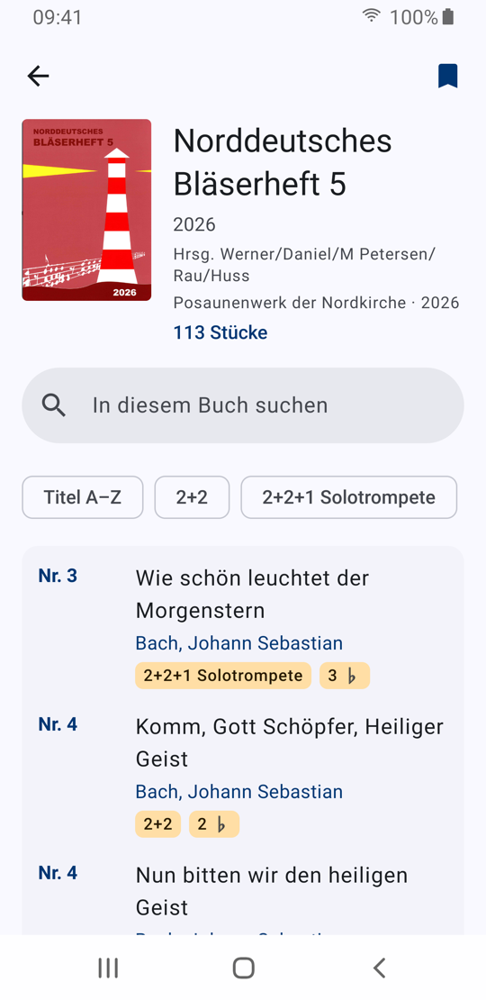 | 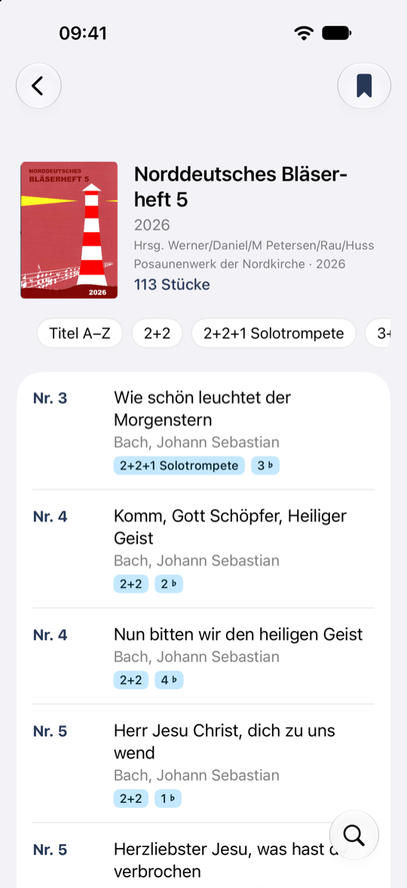 |

- Cover, Jahr, Herausgeber, Verlag und Anzahl der Stücke. Ein Tipp aufs Cover zeigt es groß. Ist der Herausgeber auch als Komponist eingetragen, führt ein Tipp auf seinen Namen zu seinen Stücken.
- Inhaltsverzeichnis des Hefts, filterbar nach Besetzung und durchsuchbar („In diesem Buch suchen“).
- **Titel A–Z** sortiert das Inhaltsverzeichnis alphabetisch statt nach Nummer im Heft.
- Erreichbar aus den Suchergebnissen (Tipp auf ein Buch), aus dem Inventar und aus der Suche.

## Gesangbuch

| Android | iOS |
|:---:|:---:|
| 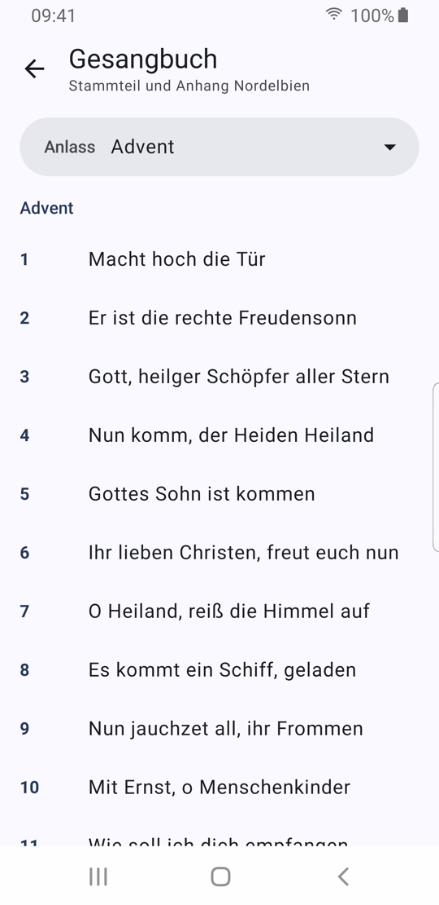 | 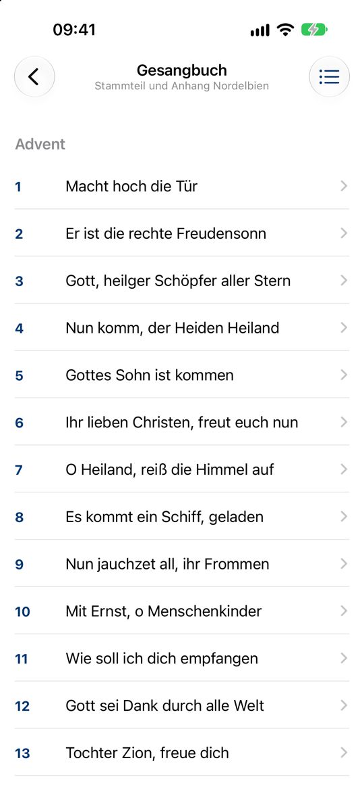 |

- Alle Lieder aus dem Stammteil des EG und dem Anhang der gewählten Landeskirche, gruppiert nach Anlass wie im Gesangbuch (Advent, Weihnachten, …, Abend).
- Lieder aus dem Anhang stehen beim passenden Anlass hinter denen aus dem Stammteil.
- Zum Springen gibt es die Liste aller Anlässe mit ihren Nummern. Auf Android öffnet sie das Feld **Anlass** über der Liste, das zugleich den aktuellen Anlass zeigt. Auf iOS öffnet sie der Knopf oben rechts, den aktuellen Anlass zeigt die Abschnittsüberschrift, die beim Scrollen oben stehen bleibt.
- Ein Tipp auf ein Lied öffnet seine Suchergebnisse.

## Listen

- **Favoriten** gibt es immer. Der Stern oben in den Suchergebnissen eines Titels oder EG-Lieds nimmt das Lied auf oder entfernt es wieder.
- Eigene Listen legt man unter „Listen“ an, zum Beispiel „Konzert 3. Advent“. Umbenennen und Löschen gehen über das Menü der Liste.
- Hinzufügen geht über „Zu Liste hinzufügen …“ in den Suchergebnissen, an jeder Fundstelle, an Suchtreffern und im Gesangbuch (Android: langer Druck oder Menü, iOS: Kontextmenü oder Wischen).
- In eine Liste kommt ein Lied, eine bestimmte Fundstelle mit Buch und Nummer oder ein EG-Lied. Bei einem Lied zeigt die Liste, in wie vielen Büchern es steht und wo im Inventar.
- Die Reihenfolge lässt sich per Ziehen ändern. Zu jedem Eintrag passt ein kurzer Kommentar, etwa „nur Strophe 1 und 3“ oder „Vorspiel 8 Takte“.
- In einer eigenen Liste darf dasselbe Lied mehrmals stehen, etwa als Eingangs- und Schlusslied. In den Favoriten nur einmal.
- Listen liegen nur auf dem Gerät und in seiner Sicherung. Teilen mit anderen ist noch nicht eingebaut.

## Inventar

| Android | iOS |
|:---:|:---:|
| 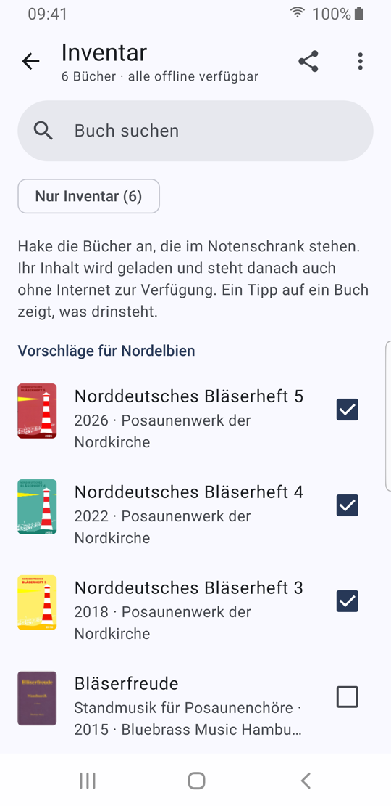 | 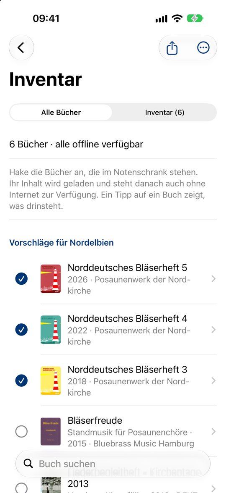 |

- Bücher aus dem Notenschrank abhaken. Die Suche zeigt dann bei jedem Treffer, in welchem eigenen Heft er steht, bei EG-Liedern auch Sätze unter einem anderen Liedtext.
- Oben stehen Vorschläge für die gewählte Landeskirche, darunter Choralbücher und alle übrigen Bücher, neueste zuerst. Ein Suchfeld filtert die Liste.
- **Inventar teilen:** Die App erzeugt einen Code (`BW2…`) und verschickt ihn per Messenger oder Mail. So bekommt der ganze Chor dieselbe Liste.
- **Inventar übernehmen:** Die Nachricht mit dem Code an die App teilen oder den Code im Menü einfügen. Das bisherige Inventar lässt sich ergänzen oder ersetzen. Auf iOS geht das direkt im Teilen-Dialog („Inventar übernehmen“), ohne die App zu öffnen.
- Android und iOS verwenden dasselbe Code-Format. Ein Code vom Android-Handy funktioniert auf dem iPhone und umgekehrt.
